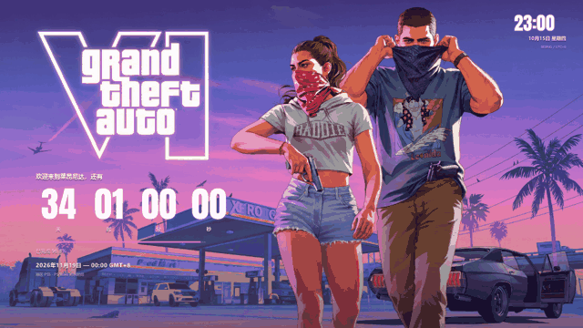
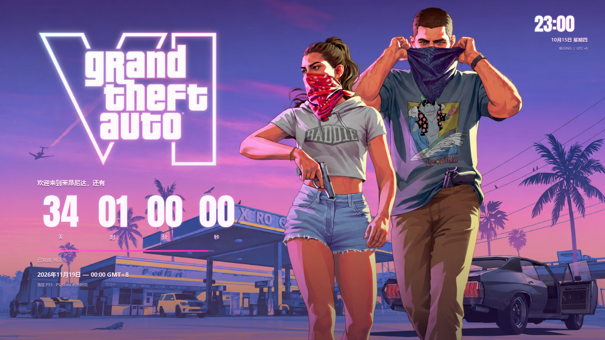

<div align="center">

# GTA VI · 北京时间倒计时壁纸

[](https://github.com/Cvandia/gta6-live-wallpaper/actions/workflows/build.yml)
[](https://www.python.org/)
[](https://docs.astral.sh/uv/)
[](https://github.com/Cvandia/gta6-live-wallpaper)
[](LICENSE.txt)
[](https://github.com/Cvandia/gta6-live-wallpaper/commits/)
[](https://github.com/Cvandia/gta6-live-wallpaper/stargazers)

霓虹轮廓 · 人物鼠标视差 · 北京时间倒计时



<details>
<summary>查看静态预览</summary>

</details>

</div>

## 📖 项目简介

以 GTA VI 官方海报为参考的 Windows 动态桌面壁纸，采用日落紫粉色界面。提供 EXE 与 Wallpaper Engine 网页版，显示距离发售的天、时、分、秒，以及固定采用北京时间的实时钟表。

Python 项目由 **uv** 管理虚拟环境和依赖，EXE 用户无需安装 Python。

## ✨ 功能

- 💜 **VI 霓虹轮廓**：粉紫至青色的渐变外发光，带缓慢呼吸与轻微忽闪
- ⏱️ **时间光效**：倒计时数字和右上角北京时间同步发光，秒级更新
- 🖱️ **人物分层视差**：人物随鼠标左右平滑轻移，默认在 1920 像素宽度下最大为 **±12 px**
- ✨ 漂浮微尘、柔光与粉色进度条
- ⚙️ 可设置目标时间、光强、视差强度、时钟、帧率与文字大小
- 🖥️ 支持独立桌面模式与 Wallpaper Engine 导入

## 🚀 下载与使用

[下载入口](https://github.com/Cvandia/gta6-live-wallpaper/releases/latest) · [查看构建状态](https://github.com/Cvandia/gta6-live-wallpaper/actions/workflows/build.yml)

首次成功构建后，GitHub Actions 会创建 `v1.1.0` 发布并附上 EXE、完整 ZIP 与 Web ZIP；在此之前下载入口可能尚不可用。已有同名标签时工作流保留已有发布与附件。

### EXE 版

下载并解压完整 `GTA6-LiveWallpaper-v1.1.0.zip`，双击 `GTA6Wallpaper.exe` 即可预览。支持 Windows 10 / 11 x64。

在窗口内右键选择 **“独立设为桌面壁纸”**，可将壁纸放到主屏桌面图标后面。右键托盘的 **VI** 图标可打开设置、返回预览或退出。

预览时按 `F11` 切换全屏，按 `Esc` 返回；普通预览窗口中按 `Esc` 退出。

### 导入 Wallpaper Engine

| 版本 | 导入入口 | 使用方式 |
| --- | --- | --- |
| EXE | `GTA6Wallpaper.exe` | 在“创建壁纸”中按应用程序导入 |
| Web | `WallpaperEngine-Web/index.html` | 在“创建壁纸”中导入网页入口，保持整个文件夹完整 |

Web 版可单独下载 `GTA6-WallpaperEngine-Web-v1.1.0.zip`，在引擎右侧调节属性；EXE 版通过右键菜单或托盘打开设置。独立桌面模式与 Wallpaper Engine 模式选择一种运行即可。

## ⚙️ 设置

| 设置 | 默认值 / 说明 |
| --- | --- |
| 动态效果 | 开启微尘、柔光等效果 |
| 霓虹光效 | 开启 VI 与时间的渐变外发光 |
| 发光强度 | **65%** |
| 人物视差 | 开启，平滑跟随鼠标左右移动 |
| 视差强度 | 1920 像素宽度下最大 **±12 px**，按显示宽度缩放 |
| EXE 动画帧率 | **20 FPS**，可选 **10 / 20 / 30 FPS** |
| 北京时间 | 开启，固定为 `UTC+8` |
| Web 跟随系统减少动态偏好 | 默认关闭，可按需要开启 |

EXE 设置保存在 `%LOCALAPPDATA%/GTA6Wallpaper/settings.json`。关闭视差可让人物停止移动；图层资源不可用时回退到官方静态原画。

程序离线运行，使用电脑系统时钟计算倒计时，不受系统选择的时区影响；不会后台校时或自动更改发售日期。

## 📅 发售时间说明

核查日期：**2026-10-15**。

Rockstar 公布的 GTA VI 发售日为 **2026 年 11 月 19 日**。港区 PlayStation Store 商品页列出的时间为 `2026-11-18 16:00 UTC`，换算后本项目默认目标为：

> **北京时间 2026 年 11 月 19 日 00:00:00（UTC+8）**

该时刻对应港区 PS5 数字版商店列示时间，其他地区及平台以各自商店为准。若官方调整日期，可在设置中修改目标时间。

倒计时到期后归零，不会显示负数。进度条从首支预告发布时刻起计算，并限制在 `0–100%`。

- [Rockstar 官方发售日期公告](https://www.rockstargames.com/newswire/article/ak3ak31a49a221/grand-theft-auto-vi-is-now-set-to-launch-november-19-2026)
- [港区 PlayStation Store 商品页](https://store.playstation.com/zh-hans-hk/product/EP1004-PPSA01547_00-GTAVISTANDARD001)

## 🛠️ 本地运行

先安装 [uv](https://docs.astral.sh/uv/getting-started/installation/)，随后在 Windows PowerShell 中执行：

```powershell
git clone https://github.com/Cvandia/gta6-live-wallpaper.git
cd gta6-live-wallpaper
uv sync --locked
uv run python src/main.py --preview
```

uv 会自动创建并使用 `.venv`，Python 版本由 `.python-version` 指定，依赖由 `uv.lock` 锁定。VS Code 中请选择 `.venv/Scripts/python.exe` 作为解释器。

独立桌面模式：

```powershell
uv run python src/main.py --desktop
```

本地预览网页版本，先从根目录素材生成 `web/assets/`，再启动静态服务器：

```powershell
uv run python tools/prepare_web.py
uv run python -m http.server 8000 --directory web
```

随后在浏览器访问 `http://localhost:8000`。`web/assets/` 不重复提交到仓库；发行包中的 `WallpaperEngine-Web/` 已带齐素材，可直接导入。

## 📦 构建 EXE

在 Windows 项目根目录执行：

```powershell
uv sync --locked --group build
powershell -ExecutionPolicy Bypass -File .\build.ps1
```

输出文件：

- `dist/GTA6Wallpaper.exe`：内置素材、Python 与 Qt 运行库的单文件程序
- `dist/GTA6-LiveWallpaper-v1.1.0.zip`：EXE、完整 Web 壁纸、说明与第三方许可
- `dist/GTA6-WallpaperEngine-Web-v1.1.0.zip`：完整网页壁纸与素材

GitHub Actions 在推送到 `main` 或手动运行后执行锁定依赖安装、Python / Web 测试及打包，并保存构建产物；首次成功构建会创建 `v1.1.0` Release。

## 📂 项目结构

```text
gta6-live-wallpaper/
├─ src/                  # Python / PySide6 壁纸程序
├─ assets/               # 原画、生成图层、字体、图标及来源记录
├─ web/                  # Wallpaper Engine 网页版源码
├─ tests/                # 倒计时、动效、网页与窗口嵌入验证
├─ tools/                # 网页素材准备工具
├─ docs/                 # 预览与使用说明
├─ Licenses/             # 第三方许可文本
├─ .github/workflows/    # Windows 测试、打包与发布
├─ pyproject.toml        # 项目信息及依赖
├─ uv.lock               # 锁定依赖
├─ .python-version       # Python 版本
└─ build.ps1             # Windows 打包脚本
```

## 🧪 验证范围

Python / Web 测试可在项目根目录运行：

```powershell
uv run python -m unittest discover -s tests -p "test_*.py" -v
node tests/test_web.cjs
node tests/test_web_effects.cjs
```

Web 测试需要 Node.js。Windows 原生窗口嵌入测试另见 `tests/test_embedding.py`，可检查父窗口关系、缩放与宿主退出清理。

本机 Wallpaper Engine 内的最终显示尚未完成实机确认；导入后如需适配具体版本或多显示器环境，可附复现步骤提交 Issue。

## 🎨 素材来源与分辨率

- **官方原画**：Rockstar Games 的 **Jason and Lucia Robbery (With Logo)**，下载原图为 **3840 × 2160**，保留作静态回退背景。
- **动态分层**：背景补图与透明人物使用 ImageGen 辅助生成，实际分辨率为 **1672 × 941**。动态模式按屏幕尺寸缩放，不将生成图层标称为原生 4K。
- 分层提示与效果遮罩说明见 [图层素材说明](docs/图层素材说明.md)。
- [Rockstar 官方壁纸与原画页面](https://www.rockstargames.com/VI/media/artwork-wallpapers)
- 数字字体：[Anton](https://fonts.google.com/specimen/Anton)，采用 SIL Open Font License 1.1；中文调用 Windows 已安装字体，不重新分发系统字体。
- 软件使用 [PySide6 / Qt](https://www.qt.io/qt-for-python)、[PyInstaller](https://pyinstaller.org/) 与 [uv](https://docs.astral.sh/uv/)。

## 📜 许可与声明

本项目是非官方个人壁纸项目，与 Rockstar Games、Take-Two Interactive 或 Wallpaper Engine 无隶属关系。

原创程序源码按 [MIT License](LICENSE.txt) 开放；GTA VI 角色、原画、标志与商标归各自权利人所有，不属于 MIT 授权范围。生成图层用于本项目的视觉分层，不改变原有角色与商标的权利归属。字体和运行库分别遵循其原有许可，详见 [第三方说明](Licenses/第三方说明.md)。

## 🙏 感谢

- [Rockstar Games](https://www.rockstargames.com/VI)：GTA VI 与官方视觉素材
- [Wallpaper Engine](https://www.wallpaperengine.io/)：动态壁纸平台
- [Astral uv](https://docs.astral.sh/uv/)：Python 项目与依赖管理
